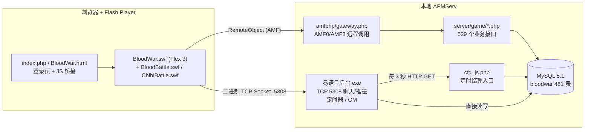

# 热血三国单机版 Flash → H5 重构：项目分析

> 分析对象：`start.exe`（130MB）及 `docs/` 下的参考资料
> 分析日期：2026-10-19
> 结论均来自对安装包的实际解包、数据库加载和 SWF 反编译；推断性内容会单独标注。

---

## 1. 结论摘要

1. `start.exe` 不是 Flash 播放器，而是一个 **RAR 自解压包**，里面是一整套 Windows 本地服务器：APMServ 5.2.6（Apache + PHP 5.2 + MySQL 5.1）+ 游戏站点 + 易语言写的"后台"程序。游戏本体是 **《热血三国》1.12 版** 的私服单机化版本。
2. 游戏是标准的 **客户端 / 服务端** 架构：
   - 客户端：Flex 3 编译的 `BloodWar.swf`（1000×600），另有两个独立战场模块 `BloodBattle.swf`、`ChibiBattle.swf`。
   - 服务端：**PHP 明文源码**（764 个文件、约 10.9 万行）通过 AMFPHP 对外提供 **529 个业务接口**。
   - 数据库：MySQL `bloodwar` 库，**481 张表**，约 82MB。
   - 实时通道 + 定时驱动：易语言 `热血三国后台5.04.12.exe`（闭源原生程序）。
3. **可复用程度很高**：
   - 服务端业务逻辑是明文 PHP，可以作为 NestJS 重写的直接依据，也能在 Docker 中原样运行，作为新旧结果比对的基准。
   - 客户端 SWF 用 JPEXS FFDec 反编译 **0 错误、几乎无混淆**，2553 个类全部还原成可读 AS3，可以作为 H5 重写的"施工图纸"。
   - 素材：外部图片约 5000 张（79MB）可直接使用；SWF 内嵌位图可批量导出且保留语义化命名。
4. **真正的难点**有三个：
   - 客户端界面量大：约 **165 个对话框、226 个面板类**，业务代码（反编译后）约 42 万行。
   - 易语言后台是黑盒：战争事件、联盟事件推送、野地刷新等逻辑 **只存在于这个原生程序里**，PHP 中没有对应实现，必须根据数据表和客户端协议重新实现。
   - 两个独立战场（战场 / 赤壁）各约 9 万行，复杂度高，建议放在后期。
5. 已确定的路线：**用 NestJS 一次性重写服务端（沿用原 481 张表结构）+ 用 TypeScript 重写 H5 客户端**，定时结算与实时推送并入 NestJS，替代易语言后台。通信从 AMF 换成 JSON / WebSocket，但保留原有的命令格式，使新客户端可以按旧客户端逐模块对照迁移；旧版 PHP 原样运行作为差分测试的对照基准。详见 [02-开发计划.md](./02-开发计划.md)。

---

## 2. 安装包结构

`start.exe` 在偏移 `288256` 处是一个 RAR4 压缩包，共 10257 个文件，解压后为 `APMServ5.2.6/`：

| 目录 / 文件 | 大小 | 说明 |
|---|---|---|
| `www/htdocs/` | 106MB | 游戏站点（客户端 SWF + PHP 服务端 + 素材） |
| `MySQL5.1/data/bloodwar/` | 82MB | 游戏数据库原始 MyISAM / InnoDB 文件 |
| `PHP/` | 33MB | PHP 5.2（含 mcrypt、eAccelerator 等扩展） |
| `Apache/`、`nginx/`、`MySQL4.0/`、`Memcached/` 等 | — | APMServ 集成环境自带组件（游戏未用到 Memcached） |
| `[1]APMServ.exe` | — | 集成环境启动器 |
| `[2]热血三国后台5.04.12.exe` | 3MB | 易语言后台：定时驱动、聊天/推送服务、GM 功能 |
| `[3]进入游戏.url` | — | 指向 `http://127.0.0.1/` |
| `config.ini` | — | 后台配置：数据库账号、聊天端口 5308、野地刷新 8 小时、每 3 秒访问 `cfg_js.php` |

`docs/` 中的参考资料：

- `热血三国数据库词条解释.txt`：约 70 张表的中文含义（社区整理，部分带问号，需要核实）。
- `网页热三单机修改器 1.2.7 / 1.4.9`：易语言写的 GM 修改器，直接连 MySQL 改数据。功能包括元宝、名将/将领管理、装备增删改（带图片预览）、史诗任务、公告、城内外建筑和科技一键满级、玩家数据清理等。可作为新版 GM 工具的需求清单。

---

## 3. 原系统运行架构



### 3.1 登录流程

1. 浏览器打开 `BloodWar.html`，HTML 层展示登录表单。
2. 表单通过 `<script>` 注入方式请求 `server/game/forlogin.php?type=0&passport=..&password=..&passtype=uuyx`，返回 `loginNow(1)` 之类的 JS。
3. 成功后显示 Flash，调用 SWF 的 `onLogin()`；SWF 内部用 `RemoteObject(source="Login")` 调 `doLogin` 拿到 `uid` 和 `sid`（会话 ID）。
4. 新用户走 `Login/CreateRoleDialog` 创建角色、选州郡。

### 3.2 业务调用协议（AMF）

客户端所有业务操作都走 `Command.sendCommand(param[])`（`server/game/Command.php`），参数是一个扁平数组：

```
[uid, sid, type, ...]
type = 1（对话框命令）: cid, receiverID, receiverParam, ttype, 函数名, ...参数
type = 0（城市命令）  : cid, ret_type
type = 2（全局命令）  : 返回标记, 函数名, ...参数
```

- 服务端用 `function_exists($commandFunc)` + 白名单 `$GLOBALS['openfunc']`（定义在 `lang.php`，**529 个函数**）做分发。
- 返回值形如 `[1, type, ..., 结果]` 或失败时 `[0, 错误消息]`。
- 每次调用前 `checkUserAuth($uid,$sid)` 校验会话（会话 ID 缓存在 `server/game/sessions/<uid>` 文件里）。
- 每个用户有一把并发锁 `newLockUser / newUnlockUser`。
- 其他 AMF 服务类：`Login`、`ConfigInfo`、`BattleCommand`、`CityCommand`、`BattleLogin`、`ShaChang`、`ExternService` 等。

**加密**：服务端定义了 `ENCRYPT_PROTOCOL=true`，客户端有 `secret/SGCrypto`（DES-ECB + PKCS5，密钥藏在 `swf/pass/*.swf` 的 100 个小 SWF 中）。但单机版的 `pass.js` 里 `getEncryptProtocol()` 返回 `false`，**实际运行时未启用加密**，重构时可以直接去掉。

### 3.3 聊天 / 推送协议（TCP 5308）

由易语言后台提供。客户端 `Chat/ChatSocket.as` 的分帧格式（全部小端序）：

| 方向 | 帧格式 |
|---|---|
| 客户端 → 服务端 | `byte 1` + `short 过程号` + `int 长度` + 负载 |
| 服务端 → 客户端 | `byte 类型(2=应答, 3=通知)` + `short 过程号` + `int 长度` + 负载 |
| 握手 | 连接建立后客户端先发送 23 个 `0x00` 字节 |

过程号（来自 `Chat/ChatPanel.as`）：

| 编号 | 名称 | 编号 | 名称 |
|---|---|---|---|
| 1 / 2 | 登录 / 登出 | 15 | 系统通告 `NOTIFY_INFORM` |
| 3 / 4 | 世界聊天 / 通知 | 16 | 频道控制 |
| 5 / 6 | 联盟聊天 / 通知 | 17 | **联盟事件** `NOTIFY_UNION_EVENT` |
| 7 / 8 | 私聊 / 通知 | 18 / 19 | 盟友上线 / 下线 |
| 9–11 | 屏蔽词获取 / 增 / 删 | 20–23 | 好友 / 仇人增删 |
| 12 / 13 | 禁言 / 解禁 | 25–27 | GM 对话 |
| 14 | GM 喊话 | 50–53 | 战场聊天、**战争事件** `NOTIFY_WAR_EVENT` |
| | | 60–63 | 赤壁聊天、赤壁事件 |

这条通道不只是聊天，它是 **整个游戏唯一的服务端主动推送通道**：战争事件、联盟事件、系统公告、好友上下线都靠它下发。

### 3.4 定时驱动

游戏没有自己的常驻进程，所有"时间流逝"的结算由外部触发：

- 易语言后台每 3 秒 HTTP 访问一次 `server/game/cfg_js.php`，依次执行：
  `HandleTroop`（出征/返回）、`HandleBattle`（战斗）、`HandleHeroHexprs`（将领历练）、`UpdateUsersCurse`（天灾人祸、排行）、`UpdateUsersTechnic`（科技）、`UpdateUsersSoldier`（造兵）、`UpdateUsersDeinforce`（城防）、`HandleAutoTrans`（自动运输）、`HandleTrade`（交易）。
- 易语言后台**自身**还直接读写数据库，处理：`mem_war_event`、`mem_union_event`（读取后通过 5308 推送）、`mem_world` 野地刷新（每 8 小时）、`sys_inform` 公告、竞技场排行奖励、史诗任务等。
- 证据：`mem_war_event` 在 PHP 中有 6 处写入、**0 处读取**；`mem_union_event` 1 处写入、0 处读取。也就是说这部分消费逻辑只存在于易语言程序中。
- `server/cronServer/` 下还有一套 Linux 版定时框架（`TimerCronServer.php` 等），但几乎是空壳，只有每天清理历练信息一项。

### 3.5 浏览器 JS 桥接

SWF 通过 `ExternalInterface.call` 调用页面 JS 的函数，重构后需要在新客户端内部实现等价能力：

`getEncryptProtocol`、`getSwfPassFile`、`getPassType`、`getImagePath`、`localeName`、`getSaved/SetSave Username/Password`（记住账号密码）、`isNowUpdateVersion`、`isFromWebPage`、`getTip`、`eval`（刷新页面）。

---

## 4. 客户端分析（Flash）

### 4.1 SWF 清单

| 文件 | 尺寸 | 说明 | 规模 |
|---|---|---|---|
| `BloodWar.swf` | 1000×600 | 主客户端（Flex 3） | 2553 个类，反编译业务代码约 42.3 万行，内嵌位图 648 张 |
| `BloodBattle.swf` | — | 战场模块（独立 SWF） | 559 个类，非框架代码约 9.3 万行 |
| `ChibiBattle.swf` | — | 赤壁之战模块（Cairngorm 风格 MVC） | 1244 个类，非框架代码约 8.9 万行 |
| `common2.swf` | — | 公共 UI 资源 | 内嵌位图 325 张 |
| `framework_3.x.swf/.swz` | — | Flex 框架运行时共享库 | 不需要迁移 |
| `swf/skin.swf`、`UIParts.swf`、`button_up.swf`、`bloodwarskin*.swf` | — | 矢量皮肤、按钮 | 需栅格化为 PNG |
| `swf/trooper*.swf`、`battleRound.swf`、`fight.swf`、`heroBattleEffect.swf`、`unActiveHero.swf`、`announce_entry.swf` | — | 帧动画（10–37 帧） | 需导出为序列帧 / 精灵图集 |
| `swf/pass/src/1..100.swf` | — | 加密密钥载体 | 不需要迁移 |

反编译质量：三个主 SWF 均 **0 个反编译失败**，类名、方法名、变量名基本完整（仅极少数局部变量为 `_loc1_` 形式），可以直接读懂业务逻辑。

### 4.2 主客户端代码结构

核心骨架类（根包）：

- `BloodWar`（应用主类，8223 行）：启动、登录、资源加载、全局事件。
- `Command` / `BattleCommand`：封装 `sendCommand / sendDialogCommand / sendGlobalCommand / sendCityCommand`，是新客户端网络层要首先移植的部分。
- `DialogManager` / `NewDialogManager`：对话框管理。
- `GlobalModel`、`Global`、`User`、`City`、`ServerTime`、`Define`、`Utils`、`UpgradeCondition`。
- `CityPanel`（城外：农田、伐木场、采石场、铁矿）、`CityInnerPanel`（城内：官府、民房、兵营、马厩、书院、市场、客栈、仓库、铁匠铺、城墙、箭塔、校场、寺庙等）。
- `Bar/`：`TopPanel`（资源栏）、`BottomPanel`（功能按钮 + 聊天栏）、`ActivityBar`、`InformBar`、`BattleInfoPanel`。

各功能模块规模（按反编译行数排序，便于估算工作量）：

| 模块 | 中文含义 | 行数 | 类数 |
|---|---|---|---|
| World | 世界地图、宣战、迁城 | 36088 | 67 |
| Union | 联盟 | 26167 | 44 |
| Rank | 排行榜 | 22923 | 95 |
| Ground | 野地 | 16792 | 21 |
| GuoGuanZhanJiang | 过关斩将 | 16071 | 15 |
| MarrySystem | 婚姻系统 | 16018 | 20 |
| Market | 市场、交易、自动运输 | 15238 | 33 |
| Troop | 军队调度 | 14203 | 37 |
| Goods | 宝物 / 道具 | 13646 | 20 |
| Hero | 将领 | 13374 | 17 |
| Stat | 统计 | 12832 | 64 |
| Hotel | 客栈（招募将领） | 11335 | 22 |
| UserInfo | 君主信息 | 11280 | 11 |
| Arena | 竞技场 | 11232 | 16 |
| BlackSmith | 铁匠铺（装备） | 10661 | 12 |
| Report | 战报 / 报告 | 9928 | 22 |
| Government | 官府 | 9632 | 14 |
| Bar | 主界面栏 | 8109 | 6 |
| Shop | 商城 | 8054 | 7 |
| war | 战争 | 7839 | 12 |
| Army | 兵营 / 造兵 | 7224 | 12 |
| Achivement | 成就 | 6792 | 12 |
| Office | 官职 | 6340 | 19 |
| LuoYang | 洛阳争夺 | 6200 | 10 |
| Battle | 战斗 | 5596 | 4 |
| Building | 建筑 | 5405 | 13 |
| Armor | 装备 | 5218 | 6 |
| Wall | 城墙 / 城防 | 5030 | 10 |
| Barn | 粮仓 | 4847 | 8 |
| Chat | 聊天 | 4304 | 5 |
| Mail | 邮件 | 4119 | 9 |
| Task | 任务 | 3830 | 7 |
| Login | 登录 / 创建角色 / 新手 | 3697 | 3 |
| 其余 | Store、Tooltip、College、friend、System、Adult、Trick、UI、Lottery、Buffer、guide、Honglu 等 | 合计约 2.5 万 | — |

> 注：反编译出的 MXML 组件代码比原始源码冗长很多（布局、数据绑定都展开成了 AS3），实际"界面工作量"更适合用对话框数量衡量：**约 165 个 Dialog、226 个 Dialog/Panel/View 类**。

第三方库：`com.hurlant.crypto`（加密）、`com.adobe.serialization.json`、`com.flexkf.htmlarea`（富文本编辑，用于邮件等）、`Nireus.Base`（资源加载与 Socket 封装）。

### 4.3 界面特征

- 固定分辨率 **1000×600**，帧率 10fps（Flex 应用，主要是静态界面 + 局部动画）。
- 未嵌入任何字体，文字全部使用系统字体（中文环境下为宋体 12px），H5 中需选定替代字体并接受细微排版差异。
- 大量使用 Flex 组件：DataGrid、List、TabNavigator、TextArea、Tooltip、富文本 `htmlText`。这些在 H5 中都需要按原皮肤重新实现。
- 世界地图为 500×500 = 25 万格（来自 `mem_world` 行数），地形 7 种（草地、森林、丘陵、湖泊、沼泽、荒漠、平地，对应 `mem_world` 的 7 种野地类型）+ 城池图标（23 种）+ 等级标记 + 9 色联盟旗帜，必须做视口裁剪 / 分块渲染。

---

## 5. 服务端分析（PHP）

### 5.1 概况

- 位置：`www/htdocs/server/`，**PHP 明文 UTF-8 源码**，未加密（`Zend` 目录只是集成环境自带的 ZendOptimizer）。
- 764 个 PHP 文件，约 10.9 万行。核心业务在 `server/game/`。
- 运行环境：PHP 5.2 + AMFPHP 1.x。

最大的业务文件：

| 文件 | 行数 | 函数数 | 内容 |
|---|---|---|---|
| `GoodsFunc.php` | 5313 | 133 | 宝物 / 道具使用 |
| `BattleFunc.php` | 4529 | 105 | 战斗计算 |
| `TaskFunc.php` | 2673 | 54 | 任务 |
| `lang.php` | 2663 | — | 文案 + 接口白名单 |
| `UnionFunc.php` | 2527 | 67 | 联盟 |
| `HotelFunc.php` | 2416 | 53 | 客栈 / 将领招募 |
| `HeroFunc.php` | 2300 | 50 | 将领 |
| `utils.php` | 2215 | 116 | 公共工具 |
| `EquipmentFunc.php` | 1923 | 42 | 装备 |
| `CityFunc.php` | 1842 | 29 | 城池 |
| `OLdBattleCron.php` / `cfg_js.php` | 1706 / 1685 | — | 定时结算 |
| `GroundFunc.php`、`UtilsExtend.php`、`PKFunc.php`、`ArmorFunc.php`、`HeroExpr.php`、`WorldFunc.php`、`TrickFunc.php`、`UserFunc.php` … | 各 1000–1600 | — | 野地、PK、装备、历练、世界、计谋、用户 |

### 5.2 可删除的部分（单机不需要）

- 平台接入：`51SDK/`、`xiaonei/`、`agents/`（官方 / 同学网 / ImPlay）、`get91WanUserInfo.php`、各种 `pay*.php`、`charge51.php`、`passport/` 多平台登录。
- 跨服：`BattleNetFunc.php`、`BattleNetServices.php`、`ChibiNetFunc.php`、`AssembleKuaFu.php`（单机配置中 `BATTLE_NET_ENABLE=false`、`CHIBI_NET_ENABLE=false`）。
- 运维统计接口：`GetUsersOnlineCount.php`、`GetActivatedUsers.php` 等。
- 防沉迷 `AdultFunc.php`（可保留开关但默认关闭）。
- 测试 / 临时目录：`tempaaa/`、`test.php`、`autofortest.php`。
- 加密：`secret/SGCrypto.php`、`key*.php`、`swf/pass/`。

### 5.3 升级到现代 PHP 的兼容性工作量（评估记录）

> 后端已确定改用 NestJS 重写，不再升级 PHP，本节仅作为评估记录保留。对照环境使用 PHP 5.6 原样运行原代码，不需要这些修改。

扫描结果（排除临时目录）：

| 问题 | 文件数 | 出现次数 | 处理方式 |
|---|---|---|---|
| `mysql_*` 函数 | 3 | 52 | 集中在 `lib/` 的数据库封装里，替换成 mysqli / PDO 即可 |
| `ereg` / `split` | 4 | 11 | 改为 `preg_*` / `explode` |
| `each()` | 3 | 3 | 改为 `foreach` |
| `mcrypt_*` | 1 | 5 | 随加密功能一起删除 |
| 短标签 `<?` | 8 | 10 | 改为 `<?php` |
| `$str{n}` 花括号下标 | 1 | 2 | 改为 `$str[n]` |
| `get_magic_quotes_*` | 2 | 3 | 删除 |
| 类名同名构造函数 | 2 | 3 | 改为 `__construct` |

整体量很小，因为数据库访问统一走 `sql_query / sql_fetch_rows / sql_fetch_one / sql_fetch_one_cell` 这几个封装函数。此外还需要处理 PHP 8 对未定义变量 / 下标、字符串与数字比较等行为变化，这部分只能靠运行测试发现。

### 5.4 安全性说明

原代码大量使用字符串拼接 SQL（如 `"select * from sys_user where uid='$uid'"`），存在注入风险。NestJS 重写时所有查询统一使用参数绑定，并在命令网关做参数类型校验，从根本上消除这个问题。

---

## 6. 数据库分析

用 MySQL 5.7 容器直接挂载原 5.1 数据目录成功读取，已导出完整表结构和数据（`bloodwar_schema.sql` 约 314KB、`bloodwar_full.sql` 约 50MB）。

### 6.1 表分布

| 前缀 | 表数 | 行数 | 含义 |
|---|---|---|---|
| `sys_` | 146 | 70.1 万 | 玩家与世界的持久数据（用户、城池、将领、装备、联盟、部队…） |
| `cfg_` | 143 | 14.1 万 | 静态配置（建筑、兵种、科技、将领、宝物、任务、商城、战场…） |
| `mem_` | 61 | 27.3 万 | 运行时状态（世界格子、建造/科技队列、资源、事件、服务器状态） |
| `log_` | 65 | 372 | 日志 |
| `rank_` | 34 | 4572 | 排行榜 |
| 其他（`adm_`、`pay_`、`huangjin_`、`fc_` 等） | 32 | 少量 | 后台、充值、史诗任务、防沉迷 |

存储引擎：MyISAM 426 张、InnoDB 53 张、MEMORY 2 张。

### 6.2 当前数据快照

- 用户 899 个：真实玩家 **2 个**（uid > 1000），NPC 君主 897 个。
- 城池 7050 座（`mem_world.type=0`），野地约 24.3 万格（type 1–7）。
- 配置量：宝物 `cfg_goods` 11410 条、装备 `cfg_armor` 2111 条、任务 `cfg_task` 10235 条、兵种 `cfg_soldier` 95 种、科技 28 项、NPC 将领 927 名、战场 11 个。
- `mem_state` 表保存服务器状态（如开服时间、排行更新时间、聊天后台最低版本等）。

### 6.3 迁移到新版 MySQL 的注意点

- **保留字冲突**：有 44 个列名叫 `rank`，在 MySQL 8.0.2 及以后是保留字；PHP 中有约 158 处未加反引号的使用（集中在 8 个文件）。要么全部加反引号，要么改用对此更宽松的数据库版本。
- **SQL 模式**：原代码依赖 MySQL 5.1 的宽松行为（隐式类型转换、零日期、非严格 GROUP BY 等），新库需设置宽松的 `sql_mode`，后续再逐步收紧。
- **字符集**：数据为 utf8，抽查中文正常，建议迁移为 `utf8mb4`。
- **引擎**：MyISAM 无事务，可先原样迁移，稳定后再转 InnoDB。
- 社区的 `热血三国数据库词条解释.txt` 只覆盖约 70 张表且有不确定项，需要结合 PHP 代码中的实际用法补全成正式数据字典。

---

## 7. 素材分析

### 7.1 外部素材（可直接使用）

`www/htdocs/images/`，共约 5000 个文件、79MB：

| 目录 | 文件数 | 大小 | 内容 |
|---|---|---|---|
| 根目录 | 2334 | — | 道具 `item_*`（673）、礼包 `pack_*`（383）、物品 `thing_*`（262）、计谋、科技、建筑介绍、地形、兵种、登录页等 |
| `armor/` | 765 | 4.6MB | 装备图标 |
| `influence/` | 476 | 1.9MB | 势力范围图块 |
| `chibi/` | 328 | 34MB | 赤壁战场素材 |
| `herox/`、`hero/` | 209 / 208 | 2.5MB | 将领头像 |
| `heroskill/` | 192 | 1.1MB | 将领技能图标 |
| `achievement/` | 148 | 740KB | 成就图标 |
| `index/` | 116 | 3.3MB | 大图：世界地图、战场地图、背景 |
| `player/` | 74 | 1.4MB | 君主形象 |
| `battle/`、`luoyangBattle/`、`azp/` | 42 / 26 / 18 | — | 战斗、洛阳战、纸娃娃（男 / 女） |

### 7.2 SWF 内嵌素材（需导出）

- 位图：`BloodWar.swf` 648 张、`common2.swf` 325 张、`ChibiBattle.swf` 83 张、`BloodBattle.swf` 38 张。已验证可用 FFDec 批量导出为 PNG，文件名带有原类名，如 `World.WorldPanel_citymark3.png`、`Bar.BottomPanel__embed_css_images_function_friend_down_png_xxx.png`，便于与代码对应。
- 矢量皮肤：`skin.swf`（177 个精灵）、`UIParts.swf`（47 个）、`button_up.swf`（30 个）等，需导出为 PNG（建议 2 倍分辨率以适配高分屏）。
- 帧动画：士兵行军（18 帧）、战斗回合（37 帧）、打击特效（10 帧）等，需导出序列帧并合成精灵图集。
- 声音：所有 SWF 中 **没有声音资源**，游戏本身无音效。

---

## 8. 技术选型

### 8.1 总体路线（已确认）

**"服务端一次性重写为 NestJS + 客户端重写"**，数据库沿用原表结构：

- 客户端必须重写（Flash 已停止支持），反编译代码作为逐个界面对照的参考。
- 服务端用 NestJS 按模块一次性重写 PHP 业务逻辑，前后端统一为 TypeScript，可共享协议类型、常量和文案。
- 数据库沿用原 481 张表的结构，原存档和配置数据直接可用，也便于和旧版结果逐条对照。
- 旧版 PHP 不升级，只在 Docker 中原样运行，作为差分测试的对照基准，用来控制重写带来的规则走样。
- 通信层从 AMF 换成 JSON，但保留 `sendCommand(函数名, 参数)` 的命令格式和返回结构。

### 8.2 技术栈

| 层 | 选型 | 理由 |
|---|---|---|
| 客户端语言与构建 | TypeScript + Vite | 类型安全，便于对照 AS3 迁移（AS3 与 TS 语法非常接近） |
| 界面层 | Vue 3 + Pinia（DOM 渲染） | 165 个对话框以表单、表格、列表、富文本为主，DOM 实现成本最低、文字渲染最清晰 |
| 场景层 | PixiJS v8（Canvas/WebGL） | 世界地图 25 万格、城池视图、战斗动画需要高性能 2D 渲染 |
| 适配 | 1000×600 设计分辨率等比缩放 | 与原素材像素一致，避免重新做图 |
| 服务端框架 | Node.js + NestJS | 模块化结构清晰，依赖注入便于测试；与客户端同为 TypeScript |
| 数据访问 | Kysely + kysely-codegen | 由现有库生成 481 张表的类型；支持直接迁移原手写 SQL，并统一使用参数绑定 |
| 命令网关 | NestJS Controller + 装饰器注册表 | 保持原 `sendCommand` 的输入输出格式，替代 AMFPHP 与 `openfunc` 白名单 |
| 定时结算 | `@nestjs/schedule` | 3 秒结算循环、分钟 / 小时 / 天任务、野地刷新，替代易语言后台的定时驱动 |
| 实时通道 | `@nestjs/websockets` + ws（沿用原过程号） | 替代 TCP 5308 聊天 / 推送服务，浏览器原生支持 |
| 数据库 | MySQL 8.4（InnoDB、utf8mb4、宽松 sql_mode） | 本机已有镜像；保留 MySQL 5.7 作为对照库 |
| 对照环境 | PHP 5.6 + MySQL 5.7（Docker） | 原样运行旧服务端，作为差分测试基准 |
| 部署 | Docker Compose 一键启动 | 跨平台替代 Windows 专用的 APMServ |

### 8.3 备选方案与取舍

| 方案 | 优点 | 缺点 | 结论 |
|---|---|---|---|
| Ruffle 直接运行原 SWF | 几乎零开发 | 对 Flex 3 / AS3 支持不完整，不是真正的 H5 重构，后续无法维护 | 只用作旧版行为对照工具 |
| LayaAir 编译 AS3 | 历史上的 Flash 转 H5 方案 | LayaAir 3 已放弃 AS3；Flex 组件无法直接编译 | 不采用 |
| Cocos Creator / Phaser 全 Canvas | 游戏引擎能力强 | 大量表单/表格/富文本在 Canvas 中实现成本高，中文小字号渲染发虚 | 不采用 |
| 保留并升级 PHP 8 + Workerman | 复用全部业务逻辑，最快跑通 | 长期维护 PHP 与 TS 两套技术栈；旧代码 SQL 拼接、无事务等问题延续 | 不采用 |
| 渐进替换（先升级 PHP 作临时后端，再逐模块改写为 NestJS） | 客户端开发不必等待后端 | 要先做一遍 PHP 升级，存在两套后端并存的过渡期，总工作量更大 | 不采用 |
| 一次性重写为 NestJS | 技术栈统一、代码质量可控、可共享类型 | 重写周期长，规则存在走样风险 | **采用**，用差分测试控制走样风险 |
| 重新设计数据库结构 | 结构更规范 | 需要数据转换脚本，新旧结果难以直接对照 | 不采用，沿用原表结构 |

---

## 9. 主要风险

| 风险 | 影响 | 应对 |
|---|---|---|
| 易语言后台是黑盒，战争 / 联盟事件推送、野地刷新、史诗任务等规则只能推断 | 相关玩法行为可能与原版不一致 | 根据 `mem_*` 表结构、客户端 `onNotifyWarEvent / onNotifyUnionEvent` 的解析代码、exe 内 SQL 字符串反推；必要时在 Windows 虚拟机中运行原版抓包对照 |
| 界面量大（约 165 个对话框） | 工期主要消耗在这里 | 先做通用皮肤组件库，再按模块优先级分批迁移；对照反编译代码保证功能一致 |
| 一次性重写为 NestJS 导致数值和规则走样 | 玩法与原版不一致 | 每个模块以差分测试（新旧服务端同输入对比）通过作为完成标准；随机逻辑统一走可设种子的 RNG |
| 数据库宽松语义依赖 | SQL 报错或结果不同 | 先用宽松 sql_mode 跑通，记录告警再逐步修复 |
| 两个独立战场模块复杂度高 | 拖慢整体进度 | 放在最后阶段，可裁剪 |
| 字体与排版差异 | 部分文字溢出或错位 | 统一选用开源中文字体并逐界面校对 |
| 版权 | 原游戏代码与美术属于原开发商 | 仅用于个人学习 / 单机怀旧，不建议商用或公开运营 |

---

## 10. 附：本次分析的可复现步骤

```bash
# 1. 从自解压包中切出 RAR（RAR4 签名位于偏移 288256）
tail -c +288257 start.exe > start.rar
# 系统自带 bsdtar 解不开该压缩算法，使用 node-unrar-js（WASM）解压
npm i node-unrar-js@2   # 然后调用 createExtractorFromFile 解压到目标目录

# 2. 用 MySQL 5.7 读取原 5.1 数据目录并导出（Apple Silicon 需 amd64 镜像）
docker run -d --name rxsg-mysql --platform linux/amd64 \
  -v <拷贝的 MySQL5.1/data>:/var/lib/mysql mysql:5.7 \
  --skip-grant-tables --lower-case-table-names=1 --innodb-log-file-size=5M
docker exec rxsg-mysql mysql -uroot -e "set global show_compatibility_56=ON"
docker exec rxsg-mysql mysqldump -uroot --set-gtid-purged=OFF bloodwar > bloodwar_full.sql

# 3. 用 JPEXS FFDec 反编译与导出素材（用 Java 17 容器运行）
java -jar ffdec.jar -cli -export script <输出目录> BloodWar.swf
java -jar ffdec.jar -cli -format image:png -export image <输出目录> BloodWar.swf
java -jar ffdec.jar -cli -format sprite:png -export sprite <输出目录> swf/battleRound.swf
```
