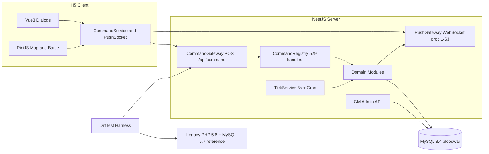
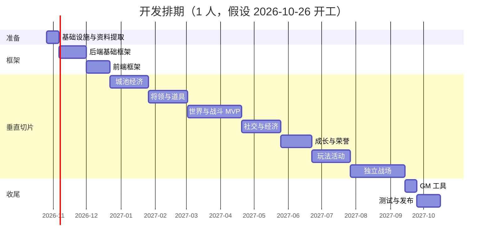

# 热血三国单机版 Flash → H5 重构：开发计划（NestJS 后端版）

> 前置阅读：[01-项目分析.md](./01-项目分析.md)
> 远程仓库：<https://github.com/HereIsYui/hot_sg_remastered>
> 工期默认按 **1 名全栈工程师** 估算（单位：周），多人并行的情况见第 8 节。

---

## 1. 目标与范围

### 1.1 目标

在现代浏览器中无需 Flash 即可运行《热血三国》单机版，玩法、数值、界面布局与原版保持一致，**沿用原版全部美术素材和游戏数据**。

### 1.2 范围内

- H5 客户端：主客户端全部功能模块；两个独立战场（战场、赤壁）放在最后阶段。
- 服务端：用 Node.js + NestJS **一次性重写** 原 PHP 业务逻辑。
- 定时结算与实时推送：在 NestJS 内实现，替代易语言后台（定时结算、世界刷新、聊天与事件推送）。
- Web 版 GM 工具：替代易语言后台的 GM 功能和 `docs/` 中的修改器。
- 一键启动的本地部署方案（Docker Compose）。

### 1.3 范围外（单机不需要，不迁移）

平台接入（51、校内、91wan、同学网等）、充值支付、跨服（BattleNet / ChibiNet / 跨服集结）、防沉迷、运营统计接口、协议加密（`SGCrypto` 与 `swf/pass`）。

### 1.4 成功标准

1. 从登录到"建城 → 造兵 → 出征 → 占领野地 → 收到战报"的完整流程可在 Chrome / Edge / Safari 中跑通。
2. 原版 529 个业务接口中，单机相关的接口全部在 NestJS 中实现，且与旧版 PHP 的差分测试结果一致。
3. 原数据库数据（2 个玩家存档 + NPC 世界）可无损迁移并继续游戏。
4. 一条命令启动全部服务。

---

## 2. 关键决策（已确认）

| 决策 | 结论 |
|---|---|
| 后端技术栈 | Node.js + NestJS（TypeScript） |
| 迁移方式 | **一次性重写**：不再升级 PHP，按模块把 PHP 改写为 NestJS |
| 数据库结构 | **沿用原 481 张表的结构**，迁到 MySQL 8.4，只做必要修正 |
| 前端技术栈 | TypeScript + Vite + Vue 3（界面）+ PixiJS（地图和战斗），设计分辨率 1000×600 |
| 旧版 PHP 的角色 | 不升级，只在 Docker 中原样运行，作为 **对照基准**：同一命令分别发给旧版和 NestJS，比对返回值和数据库变化 |
| 仓库内容 | 只放自己写的代码、文档和提取脚本，**不提交任何原版内容**（见第 4 节） |

---

## 3. 目标架构



---

## 4. 仓库结构与内容范围

### 4.1 目录结构（pnpm monorepo）

```
hot_sg_remastered/
├── apps/
│   ├── server/           # NestJS 服务端
│   ├── client/           # H5 客户端
│   └── gm/               # GM 后台（Vue，复用客户端组件库）
├── packages/
│   └── shared/           # 前后端共享：协议类型、命令名常量、推送过程号、中文文案
├── tools/                # 解包、反编译、素材导出、数据迁移、差分测试脚本
├── design/               # 分析与设计文档
├── docs/                 # 参考资料（只提交数据库词条解释）
├── legacy/               # 本地生成：解包文件、反编译源码、原库 SQL（不提交）
├── start.exe             # 开发者自备（不提交）
└── docker-compose.yml    # 开发环境（MySQL 8.4 + 服务端）与对照环境（PHP 5.6 + MySQL 5.7）
```

### 4.2 提交与排除规则

- **不提交**：
  - `start.exe`：130MB，超过 GitHub 单文件 100MB 上限，且属于原版内容。
  - `docs/` 下的两个修改器目录（exe 和 `config.ini`）。
  - `legacy/` 整个目录：解包文件、反编译源码、原库 SQL。
  - 由脚本导出的素材目录（如 `apps/client/public/assets/`）。
- **提交**：`apps/`、`packages/`、`tools/`、`design/`、`docs/热血三国数据库词条解释.txt`、`README.md`。
- 每个开发者自备 `start.exe` 放在仓库根目录，运行 `tools/` 中的脚本在本地生成 `legacy/` 和素材。
- `.gitattributes` 统一文本文件为 LF 换行；`.vscode/settings.json` 固定 UTF-8 编码，避免文件被编辑器按 GBK 读写。

---

## 5. 后端技术设计要点

| 主题 | 设计 |
|---|---|
| 数据访问 | Kysely + `kysely-codegen` 根据现有库生成 481 张表的类型。原 PHP 全是手写 SQL，Kysely 既能写类型安全的查询，也能用 `sql` 模板直接迁移原语句，比 TypeORM / Prisma 更贴近原写法。所有查询使用参数绑定，消除原代码的 SQL 拼接注入问题 |
| 命令网关 | 保持原 `Command.sendCommand` 的参数格式 `[uid, sid, type, ..., 函数名, ...参数]` 和返回格式 `[1, ...]` / `[0, 错误信息]`。业务函数用装饰器注册（如 `@Command('upgradeHero')`），替代 PHP 的 `function_exists` + `$GLOBALS['openfunc']` 白名单 |
| 其他服务 | 原 AMF 服务类 `Login`、`ConfigInfo`、`BattleCommand`、`CityCommand`、`ShaChang`、`ExternService` 映射为对应的 Controller |
| 会话与并发 | 会话沿用 `sys_sessions` 表；用每个用户一把的进程内互斥锁替代 `newLockUser / newUnlockUser` |
| 事务 | 原表大多是 MyISAM，没有事务。迁移时转为 InnoDB（只改存储引擎，不改表结构），涉及资源扣减的命令包在事务中执行 |
| 定时任务 | `@nestjs/schedule`。每 3 秒的结算循环对应原 `cfg_js.php` 的 9 个处理函数（出征、战斗、历练、天灾、科技、造兵、城防、自动运输、交易），加锁防止重入；另有分钟、小时、每天凌晨 4 点的任务，以及每 8 小时的野地刷新 |
| 实时推送 | `@nestjs/websockets` + ws，消息格式 `{type, proc, data}`，过程号沿用原聊天协议的 1–63：聊天、联盟事件、战争事件、系统通告、好友上下线，替代易语言后台的 5308 端口服务 |
| 随机数 | 原战斗、历练、招募大量使用 `rand / mt_rand`。新代码统一走可注入、可设种子的 RNG 服务；差分测试时只比对确定性结果，或固定两边的随机结果 |
| 文案 | `lang.php` / `lang_tw.php` 转为 `packages/shared` 中的 JSON 文案，前后端共用 |
| 数据库迁移 | 原库 → MySQL 8.4：字符集转 `utf8mb4`、存储引擎转 InnoDB、`rank` 等保留字列在新代码中统一加反引号、初期使用宽松 `sql_mode` |

---

## 6. PHP → NestJS 模块对照（迁移清单）

| NestJS 模块 | 来源 PHP 文件（`server/game/`） | 说明 |
|---|---|---|
| `core` | `utils.php`、`UtilsExtend.php`、`global.php`、`interface.php` | 公共函数、资源计算、权限校验 |
| `auth` | `Login.php`、`forlogin.php`、`createrole.php` | 只保留本地账号登录与创建角色 |
| `city` | `CityFunc.php`、`BuildingFunc.php`、`TechnicFunc.php`、`SoldierFunc.php`、`DefenceFunc.php`、`CityMergeFunc.php`、`WorkShop.php` | 城池、建筑、科技、造兵、城防 |
| `hero` | `HeroFunc.php`、`HeroExpr.php`、`HeroSkillFunc.php`、`HotelFunc.php` | 将领、历练、技能、客栈 |
| `item` | `GoodsFunc.php`（133 个函数，最大）、`ArmorFunc.php`、`EquipmentFunc.php`、`StoreFunc.php`、`BarnFunc.php`、`ShopFunc.php` | 宝物、装备、仓库、商城 |
| `task` | `TaskFunc.php`、`TaskFuncAdd.php`、`GuideFunc.php`、`RewardFunc.php`、`ActFunc.php`、`AchivementFunc.php` | 任务、引导、奖励、活动、成就 |
| `world` | `WorldFunc.php`、`GroundFunc.php`、`TroopFunc.php`、`updateMap.php` | 世界地图、野地、军队 |
| `battle` | `BattleFunc.php`（4529 行）、`OLdBattleCron.php`、`cfg_js.php` 中的出征与战斗结算、`ReportCron.php`、`ReportFunc.php` | 战斗计算与战报 |
| `social` | `UnionFunc.php`、`FriendFunc.php`、`MailFunc.php`、`MarketFunc.php` | 联盟、好友、邮件、市场 |
| `rank` | `RankFunc.php`、`OfficeFunc.php`、`StatFunc.php`、`VipFunc.php`、`BufferFunc.php`、`TrickFunc.php`、`LotteryFunc.php` | 排行、官职、统计、增益、计谋、抽奖 |
| `activity` | `PKFunc.php`、`LuoyangFunc.php`、`MarrySystemFunc.php`、`ShaChang.php` / `ShaChangFunc.php`、`NaoZhong.php` | 竞技场、洛阳、婚姻、沙场、闹钟 |
| `push` | 易语言后台（无 PHP 源码） | 聊天、事件推送、野地刷新、公告 |
| `gm` | 易语言后台 GM 功能、`docs/` 修改器 | GM 管理接口 |
| 不迁移 | `51SDK/`、`xiaonei/`、`agents/`、`passport/`、`pay*.php`、`BattleNet*`、`ChibiNet*`、`AssembleKuaFu.php`、`AdultFunc.php`、`secret/`、`tempaaa/`、统计接口 | 单机不需要 |

---

## 7. 阶段计划

后端每个模块的迁移步骤相同：**读 PHP 源码 → 写 NestJS 实现与单元测试 → 写差分测试用例并与旧版比对通过**；前端则 **对照反编译的 AS3 代码实现界面 → 联调 → 与旧版并排验收**。

### 阶段 0：基础设施与资料提取（1.5 周）

| 任务 | 产出 |
|---|---|
| 建 pnpm monorepo，配置 TypeScript、ESLint、Prettier | 仓库骨架 |
| 解包、反编译、素材导出、原库导出脚本固化到 `tools/` | `tools/` 脚本，本地生成 `legacy/` 和素材 |
| 对照环境：PHP 5.6 + MySQL 5.7 原样运行原服务端；脚本每 3 秒请求 `cfg_js.php` 模拟易语言后台；原客户端用 Ruffle 或 Flash 独立播放器打开 | 可对照的旧版运行环境 |
| 接口清单（529 个，标注保留 / 删除、所属 NestJS 模块）、界面清单（约 165 个对话框，标注优先级）、数据字典初稿 | `design/接口清单.md`、`design/界面清单.md`、`design/数据字典.md` |

**里程碑 M0**：旧版能在本机跑起来作对照；本地素材、源码、数据可一键生成。

### 阶段 1：后端基础框架（3.5 周）

| 任务 | 说明 |
|---|---|
| NestJS 工程 | 配置、日志、异常过滤器、健康检查、Docker Compose |
| 数据迁移脚本 | 原库 → MySQL 8.4（utf8mb4、InnoDB、宽松 `sql_mode`） |
| 类型生成 | `kysely-codegen` 生成 481 张表类型 |
| `core` 模块 | 迁移 `utils.php`（116 个函数）、`UtilsExtend.php`、`global.php` 等公共函数 |
| 命令网关 | `/api/command`、装饰器注册表、会话校验、用户锁、统一错误格式 |
| 骨架服务 | TickService 与 PushGateway（具体处理函数随各模块实现） |
| 差分测试工具 | Node 端 AMF 客户端调用旧版，JSON 调用新版；比对返回值和数据库快照差异；每次测试前两边恢复同一份数据快照 |
| `auth` 模块 | 登录、创建角色、选州郡 |

**里程碑 M1**：NestJS 能完成登录与创建角色，差分测试工具可用。

### 阶段 2：前端框架（3 周）

| 任务 | 说明 |
|---|---|
| 工程搭建 | Vite + Vue 3 + Pinia + PixiJS |
| 舞台与适配 | 1000×600 设计分辨率等比缩放；高分屏使用 2 倍素材 |
| 资源加载器 | 素材清单、分组预加载、加载进度条 |
| 皮肤组件库 | 三态按钮、九宫格面板、窗口、Tab、表格（替代 DataGrid）、滚动条、数字输入、进度条、Tooltip、富文本（替代 Flex `htmlText`）、确认框 |
| 核心移植 | `DialogManager` / `NewDialogManager`、`Command.as`（`sendCommand / sendDialogCommand / sendGlobalCommand / sendCityCommand`）、`ChatSocket`（改为 WebSocket）、`GlobalModel`、`ServerTime` |
| 主界面骨架 | 登录页、创建角色、`TopPanel`（资源栏）、`BottomPanel`（功能按钮 + 聊天栏） |

**里程碑 M2**：可以登录进入主界面。

### 阶段 3：切片一：城池经济（5 周）

| 端 | 内容 |
|---|---|
| 后端 | `city` 模块；结算循环中的科技、造兵、城防、天灾人祸；`task` 模块中的任务与新手引导 |
| 前端 | 城外资源田、城内 17 种建筑（建造 / 升级 / 拆除 / 队列）、官府、兵营、城墙、书院、任务与新手引导 |

### 阶段 4：切片二：将领与道具（5 周）

| 端 | 内容 |
|---|---|
| 后端 | `hero`、`item` 模块；结算循环中的将领历练 |
| 前端 | 将领（属性、加点、任命）、客栈招募、装备与铁匠铺、宝物、仓库、粮仓、商城 |

### 阶段 5：切片三：世界与战斗（7 周）

| 端 | 内容 |
|---|---|
| 后端 | `world`、`battle` 模块；`push` 中的战争事件；结算循环中的出征、战斗、自动运输 |
| 前端 | 500×500 世界地图分块渲染、野地、军队调度（派遣 / 侦察 / 掠夺 / 占领 / 运输 / 召回）、战报、邮件 |

**里程碑 MVP**：建城、造兵、出征、占领野地、收到战报全流程跑通（累计约 25 周）。

### 阶段 6：切片四：社交与经济（5 周）

| 端 | 内容 |
|---|---|
| 后端 | `social` 模块；`push` 中的联盟事件、聊天完整功能（屏蔽词、禁言、好友仇人） |
| 前端 | 联盟、好友、市场交易与自动运输、聊天频道 |

### 阶段 7：切片五：成长与荣誉（4 周）

| 端 | 内容 |
|---|---|
| 后端 | `rank` 模块 |
| 前端 | 官职爵位、排行榜、统计、成就、君主信息、增益、计谋、抽奖、鸿胪寺 |

### 阶段 8：切片六：玩法活动（5 周）

| 端 | 内容 |
|---|---|
| 后端 | `activity` 模块 |
| 前端 | 竞技场、过关斩将、洛阳争夺、婚姻、沙场、宣战 |

**里程碑 M8**：主客户端 `BloodWar.swf` 的功能全部迁移完成。

### 阶段 9：独立战场（7 周，可裁剪）

`BloodBattle`（约 9.3 万行）和 `ChibiBattle`（约 8.9 万行）的前后端。原本依赖跨服服务，单机下改为本地战场实例或 NPC 对手，开工前单独评审方案。

### 阶段 10：GM 工具（1.5 周）

功能参照 `docs/` 中的修改器和易语言后台：

- 玩家：搜索君主 / 账号，修改元宝、声望、爵位、官职，数据清理。
- 城池：建筑、科技一键满级，名城建筑还原。
- 将领：将领与名将管理（属性、经验、状态、放入城池）。
- 装备与宝物：增删改、模糊搜索、图片预览、发放。
- 任务与活动：史诗任务进度、活动开关。
- 公告：系统公告、登录公告、GM 喊话（经推送服务下发）。
- 世界：手动刷新野地、服务器运行 / 维护状态。

### 阶段 11：测试与发布（3 周）

| 任务 | 说明 |
|---|---|
| 全量回归 | 按界面清单逐个与旧版对照（布局、文案、交互、数值） |
| 差分测试 | 全部保留接口与旧版比对；结算循环两边各运行 24 小时后对比数据库状态 |
| 性能与兼容性 | 世界地图帧率、首屏加载、素材压缩（WebP / 图集）；Chrome / Edge / Firefox / Safari |
| 发布 | Docker Compose 一键启动；存档备份 / 恢复脚本；可选桌面壳（Tauri / Electron）；部署与开发文档 |

---

## 8. 工期汇总

| 阶段 | 内容 | 估时（周） | 累计 |
|---|---|---|---|
| 0 | 基础设施与资料提取 | 1.5 | 1.5 |
| 1 | 后端基础框架 | 3.5 | 5 |
| 2 | 前端框架 | 3 | 8 |
| 3 | 切片一：城池经济 | 5 | 13 |
| 4 | 切片二：将领与道具 | 5 | 18 |
| 5 | 切片三：世界与战斗（MVP） | 7 | 25 |
| 6 | 切片四：社交与经济 | 5 | 30 |
| 7 | 切片五：成长与荣誉 | 4 | 34 |
| 8 | 切片六：玩法活动 | 5 | 39 |
| 9 | 独立战场（可裁剪） | 7 | 46 |
| 10 | GM 工具 | 1.5 | 47.5 |
| 11 | 测试与发布 | 3 | 50.5 |

- 1 人：**MVP 约 25 周**；不含独立战场的完整版约 43.5 周；全部约 50.5 周。
- 多人：阶段 2（前端框架）可与阶段 1（后端框架）并行；从阶段 3 起每个切片的前后端可分给不同的人。按 **1 名后端 + 2 名前端** 配置，全部约 6–7 个月。
- 估时包含与旧版对照的时间，不包含美术重绘（素材全部沿用原版）。



---

## 9. 主要风险

| 风险 | 概率 | 影响 | 应对 |
|---|---|---|---|
| 一次性重写导致数值和规则与原版不一致 | 高 | 高 | 每个模块以差分测试通过作为完成标准；战斗等随机逻辑统一走可设种子的 RNG |
| 重写周期长，前端被后端阻塞 | 中 | 高 | 按切片推进，后端优先交付切片内接口；前端先用差分测试录下的旧版真实返回数据做 mock 并行开发 |
| 易语言后台是黑盒（战争 / 联盟事件、野地刷新、史诗任务） | 中 | 中 | 根据 `mem_war_event`、`mem_union_event` 表结构和客户端 `onNotifyWarEvent` 等解析代码反推；必要时在 Windows 虚拟机中运行原版抓包 |
| 转 InnoDB 和宽松模式后行为变化 | 低 | 中 | 阶段 1 先在对照库上验证，再锁定迁移脚本 |
| 界面迁移工作量超预期（约 165 个对话框） | 中 | 高 | 先完成皮肤组件库；MVP 后评估裁剪项（婚姻、过关斩将、独立战场等） |
| 对照环境搭建困难（PHP 5.x 镜像、Flash 播放器） | 低 | 中 | PHP 5.6 官方镜像（amd64）；Flash 端用 Ruffle 或 Windows 虚拟机中的独立播放器 |
| 独立战场依赖跨服，单机语义不明确 | 高 | 中 | 阶段 8 结束后单独评审，必要时裁剪 |
| 版权 | — | — | 仓库不包含任何原版内容；项目仅用于个人学习与单机怀旧 |

---

## 10. 近期行动项（阶段 0）

1. 建立 monorepo 骨架（`apps/`、`packages/`、`tools/`），推送到远程仓库。
2. 把解包、反编译、素材导出、原库导出步骤固化为 `tools/` 脚本（步骤已在分析阶段验证，见分析文档第 10 节）。
3. 搭建对照环境，确认原版能在本机完整运行。
4. 产出接口清单与界面清单，确定 MVP 的精确范围。
5. 在 Windows 虚拟机中运行一次原版，抓取 5308 端口通信与数据库变化，补齐易语言后台的行为记录。

## 11. 待确认问题

1. 是否需要支持手机浏览器（影响布局适配和触控交互的工作量）？
2. 两个独立战场是否必须做？单机下对手采用 NPC 还是取消该玩法？
3. 最终交付形态：浏览器访问本地服务（Docker）即可，还是需要打包成双击运行的桌面程序？
4. 现有数据库中的 2 个玩家存档是否需要保留？
